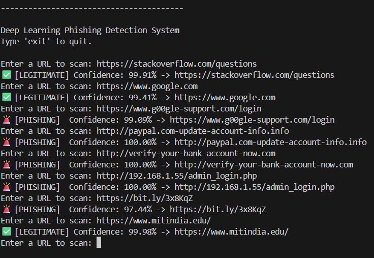
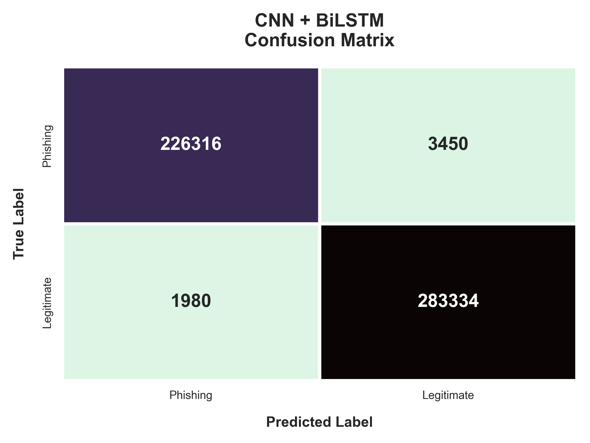

# 🛡️ DEPHIDES: Deep Learning Based Phishing URL Detection System

A highly accurate, sequence-based lexical analysis tool designed to detect zero-day phishing URLs using a hybrid **Character-Level Convolutional Neural Network and Bidirectional LSTM (CNN + BiLSTM)** architecture.

This project builds upon the foundational research of [DEPHIDES (IEEE)](https://ieeexplore.ieee.org/document/10388305) by heavily modifying the original CNN architecture. By introducing sequential modeling (BiLSTM), the model better captures the forward and backward contextual relationships inherent in typosquatting and complex phishing attacks.

---

## 🚀 Live Terminal Demonstration
The model features an interactive Command Line Interface for real-time URL scanning, capable of detecting sophisticated zero-day phishing attempts instantly:

 

---

## 🧠 Model Architecture

Traditional Machine Learning models treat URLs as a "bag of words," completely missing the sequential context. DEPHIDES reads URLs character-by-character sequentially using:
* **1D Convolutional Layers (7 Layers):** To extract spatial features and catch malicious keyword stuffing.
* **BiLSTM Layers:** To understand the forward and backward sequential context of the URL string.

### Pipeline Overview:
`Input URL` ➔ `Character Tokenization` ➔ `Embedding Layer (128-dim)` ➔ `CNN Feature Extraction` ➔ `Batch Normalization + Dropout` ➔ `BiLSTM Layer` ➔ `Dense Softmax Classifier` ➔ **`Prediction`**

---

## 📊 Performance & Results

The proposed **CNN + BiLSTM** architecture was rigorously benchmarked against standard Deep Learning and Traditional Machine Learning models using a testing set of over 515,000 unseen URLs.

### Final Master Comparison


### Champion Model Metrics (CNN + BiLSTM)
* **Test Accuracy:** 98.95%
* **Precision:** 0.99
* **Recall:** 0.99
* **F1-Score:** 0.99

**Confusion Matrix (515,080 Test URLs):**


---

## 📂 Repository Structure


```text
DEPHIDES/
├── assets/                  # Diagrams and presentation graphics
├── dataset/
│   └── big_dataset/         # Contains the 5.2M URL split (train.txt, val.txt, test.txt)
├── src/                     # Core Source Code
│   ├── dl.py                # Main training pipeline 
│   ├── dl_models.py         # Keras architecture definitions
│   ├── predict.py           # Real-time CLI deployment script
│   ├── generate_graphs.py   # Automated data visualization script
│   └── tokenizer.pkl        # Character-level vocabulary mapping
├── test_results/            # Automated benchmarking and graph outputs
│   ├── cnn_bilstm/          # Convolution Neural Network + Bidirectional Long Short Term Memory Model Results
│   ├── ann_base/            # Artificial Neural Network Baseline Results
│   ├── rnn_base/            # Recurrent Neural Network Baseline Results
│   ├── NB/                  # Navie Bayes Baseline Results
│   ├── RF/                  # Random Forest Baseline Results
│   └── SVM/                 # Support Vector Machines Baseline Results
├── requirements.txt         # Python dependencies
├── .gitignore               # Excludes large binaries and datasets
└── README.md                # Project documentation