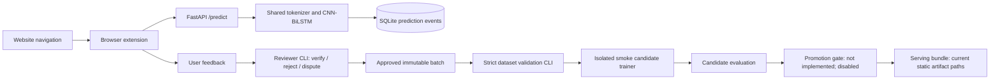
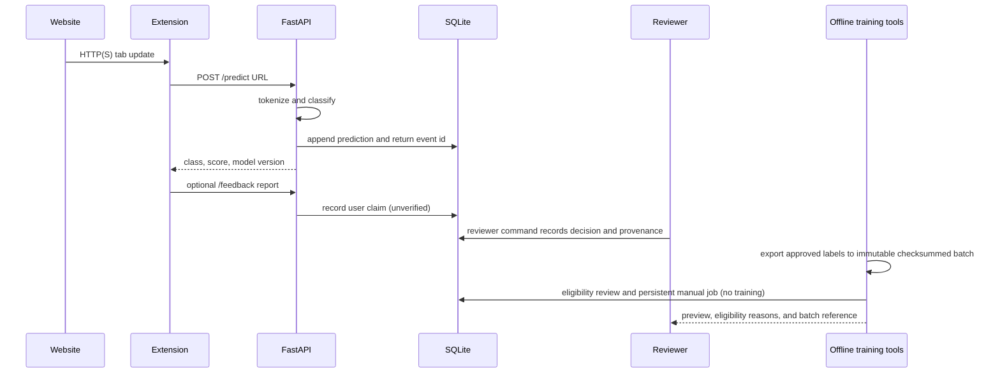

# MLOps architecture and current boundaries

The FastAPI service imports shared inference and the event database; startup performs an additive SQLite migration. Dataset validation, review, batch export, and eligibility are offline commands. A scheduled review only creates a persistent manual-worker-required job and never starts training. Existing serving paths are static and do not support live model reload. Use a controlled process restart after any separately approved artifact change. Automatic retraining and production promotion are not implemented.
# Promotion boundary

Candidate promotion and rollback use `mlops.promotion.registry`: immutable version directories, `registry.json` history, and an atomically replaced `active.json`. The active pointer is resolved by FastAPI and Streamlit through `PhishingPredictor` at process initialization. Both processes retain the loaded model in memory and require restart after a switch; no live hot reload is implemented. Promotion remains operator-only and disabled by default. See [MODEL_PROMOTION_ROLLBACK.md](MODEL_PROMOTION_ROLLBACK.md) for the gates, commands, recovery, and unresolved data prerequisites.
